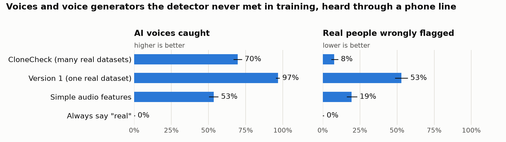

# CloneCheck: full method and results

**Track:** AI + Finance
**Team:** Gosha (solo)

*This project is a prototype and is not financial advice.*

This is the long version. The one-page write-up is [README.md](README.md); the notebook that produces every number is [CloneCheck.ipynb](CloneCheck.ipynb).

## Where each hackathon requirement is answered

| The hackathon asks | Where it is answered |
|---|---|
| Who is it for? One specific user and the moment they reach for the tool | [README](README.md), "What we built": a grandparent on a call from "a grandchild in trouble" |
| What goes in and what comes out? A real input producing a result | README example; notebook section 1 (clips you can play, with their scores); `app.py` |
| Does it beat a simple baseline? Both scores side by side | README results table; notebook section 5. Two baselines: always "real", and simple audio features |
| Where does it fail? At least one wrong example, and why | README "Where it fails"; section 4 below; notebook section 6 |
| Results from test data the model did not see | "Fair testing" below: whole generators and whole datasets are held out; each step was committed before the next was run |
| Something of your own: user, data or question | README "What we added" |
| One improvement, made and measured | Version 1 to version 2 (section 2); version 3 (section 5); version 4 (section 6) |
| One main takeaway | README, end of Results |
| Finance: a measure that fits, precision and recall rather than accuracy | AI voices caught (recall) and real people wrongly flagged, everywhere; precision in "What an alarm means" (section 1) |
| Finance: train on earlier data, test on later, if the data has dates | The clips have no dates. They are split by generator and by dataset instead |
| Finance: the line "This project is a prototype and is not financial advice." | Top of the README, this file and the notebook |
| Finance: check for unfair treatment of a group | Language, gender and accent: section 3 |
| Code that anyone can open, notebook saved with outputs | `CloneCheck.ipynb`; it re-runs in about a minute from the saved features |
| Write-up of about one page, using the template | [README.md](README.md) |
| Credits: every dataset, model, tutorial and AI tool, with links | "Sources" in the README and below |
| Rules: built during the weekend; AI is central | First commit Saturday 14 November 2026; the trained detector is the whole product |
| Rules: public or synthetic data, no personal information without permission | Public datasets, generated voices and my own voice. Nobody else was recorded, and my recordings are not in the repository. For version 4, cloning tools copied voices of speakers in the public datasets; those audio copies stay on my computer and only the numbers computed from them are published |
| Rules: honest results, including weak ones | Sections 4 to 6: it flagged me, it cannot tell my voice from a copy, and the fix that helped also doubled false alarms |

## The problem

In a "family emergency" scam, a caller pretends to be a grandchild in trouble and asks for money right now. Free AI tools can now copy a voice from a few seconds of audio: I copied my own on a laptop in five minutes. A grandparent who hears a familiar voice asking for help has no way to tell, in the moment, whether a person or a program is speaking.

## What we built

CloneCheck helps a grandparent who gets a call from "a grandchild in trouble" by taking a few seconds of the caller's voice and saying whether it sounds like a real person or an AI-generated voice.

> **In:** two 5-second clips of *"I'm in a bit of trouble and I need your help right now."* One is me. One is an AI copy of my voice. Both are heard through a simulated phone line.
> **Out:** for my recording, **Sounds like a real person** (AI-voice score 0%). For the copy, **Sounds AI-generated** (score 26%; the alarm goes off above 8%).

That pair went well. Many did not. **In short: it catches every AI voice from the generators it trained on, 70% from generators it never met, and only 30% of AI copies of my own voice made from a phone memo.** Most of this write-up is about why, because the usual way of testing these detectors hides it.

It runs as a function in the notebook and as a small web app (`python app.py`) where you record or upload a clip.

## What we added

Our own idea. The organisers' sample scam-text filter says it cannot catch family-emergency scams, because those contain no scammy words. This project goes after that case, in the form it now takes: a phone call.

- **Our own data.** 14,375 clips in English and Russian: 6,282 real voices from ten public datasets plus two recording sessions of my own voice, and 8,093 fake voices that I generated with eight AI voice generators, including AI copies of my own voice. A later experiment added 1,060 more fake clips from two voice-cloning tools (section 6).
- **Our own question.** A detector is trained on today's voice generators and today's recordings. A scam call comes from a generator it has never heard, on a microphone it has never heard, over a phone line. Does it still work then?
- **Our own user.** For a grandparent there are two different mistakes: missing a fake voice, and calling a real grandchild fake. They are reported separately everywhere.

## How it works

**Data.** Real speech comes from [FLEURS](https://huggingface.co/datasets/google/fleurs), LibriSpeech, VoxPopuli, Golos, RuLibriSpeech and five more datasets (full list under Sources). For the fake half, AI voice generators read out the same texts as the real clips, so both halves say the same kind of thing. Every clip, real or fake, is trimmed of silence, cut to 10 seconds and set to the same loudness. Each clip is scored twice: as recorded, and after a simulated landline phone call (300 to 3400 Hz, 8 kHz, mu-law).

**Model.** Each clip is passed through [XLS-R](https://huggingface.co/facebook/wav2vec2-xls-r-300m), a speech model that Meta pretrained on 436,000 hours of speech in 128 languages. We do not train XLS-R. We take the average of its layer-10 activations (1,024 numbers per clip) and train our own logistic regression on them to output the probability that the voice is AI-generated. Logistic regression was chosen because it is simple to explain and less likely to overfit a few thousand clips than a bigger model.

**Fair testing.** Everything is split by *where it came from*, not at random:

| | Train | Dev (used to choose settings) | Test (scored once, at the end) |
|---|---|---|---|
| **Voice generators** | macOS `say`, Piper, MMS | Silero | Kokoro, Bark, Chatterbox, Vosk, Chatterbox copying my voice |
| **Real-voice datasets** | FLEURS, LibriSpeech, VoxPopuli, Golos, RuLibriSpeech | English Dialects, SOVA | MInDS-14 (calls to a bank), AMI (meetings), Podlodka (podcast), my own voice (laptop) |

A second recording of my voice (phone) and its AI copy were added later, as a fresh test for version 3 (section 5). Version 4's experiment has its own extra clips, 800 for training and 260 for testing (section 6).

No FLEURS sentence is shared between train, dev and test. For the other training datasets, the train, dev and test clips come from each dataset's own separate train, validation and test parts. The plan, the settings and the final clip list were each committed to this repository before the test was run; the commit history shows the order.

**Alarm level.** Set on real dev voices so that at most 5% of them are flagged, then frozen.

## Results

### 1. On voices and generators it never met, heard through a phone line

| Method | AI voices caught (new generators) | Real people wrongly flagged (new datasets) |
|---|---|---|
| Always say "real" (simplest baseline) | 0% (0 of 1,090) | 0% (0 of 580) |
| Logistic regression on simple audio features (MFCC) | 53% (583) | 19% (113) |
| Version 1: XLS-R, real voices from one dataset | 97% (1,055) | 53% (307) |
| **CloneCheck: XLS-R, real voices from five datasets** | **70% (760)** | **8% (45)** |



Of CloneCheck's 45 wrongly flagged clips, 16 are my own voice (section 4); on the three public datasets it never met, it flagged 5% (29 of 550).

On generators and datasets it *was* trained on (but new sentences and recordings), CloneCheck caught 100% of fakes (2,038 of 2,040) and flagged 4% of real voices (69 of 1,713). The gap between 100% and 70% is the cost of a generator being new.

**What an alarm means (precision).** In this test set most never-seen clips are fake, so 94% of CloneCheck's alarms were right (760 of 805). Real life is different: almost every call is a real person. With the same 70% caught and 8% false alarms:

| AI voices among the calls checked | Alarms that are really AI | False alarms for every real catch |
|---|---|---|
| 1 in 2 | 90% | 0.1 |
| 1 in 10 | 50% | 1 |
| 1 in 100 | 8% | 11 |

So even the 8% false-alarm rate is too high for a tool that listens to every call. It would have to be used only on calls that already seem suspicious.

### 2. A perfect score was the warning

Version 1 was trained with real voices from one dataset, FLEURS. On dev data it caught every fake, including Silero, a generator it had never heard. That looked too good, so we checked real voices from other datasets: it flagged 85% of LibriSpeech audiobook readers as AI. It had learned "does this sound like a FLEURS recording?", not "is this a human?". Anything that was not FLEURS was "fake", which is also why it "caught" every fake.

The fix, chosen on dev data only: real voices from five datasets in training, each training clip also heard through the phone line, and whole datasets held out for dev and test in the same way as generators. On the test set that cut wrongly flagged real people from 53% to 8%. It also dropped fakes caught from 97% to 70%. The 70% is the honest number, because the 97% came from flagging nearly everything unfamiliar.

### 3. By generator, language and gender (CloneCheck, phone line)

| Generator (never trained on) | English | Russian |
|---|---|---|
| Vosk | | 100% (315 of 315) |
| Chatterbox | 68% (61 of 90) | 64% (58 of 90) |
| Chatterbox copying my own voice | 87% (13 of 15) | 67% (10 of 15) |
| Kokoro | 54% (196 of 365) | |
| Bark | 36% (38 of 105) | 73% (69 of 95) |

- **Language.** Real voices from the public test datasets were wrongly flagged 3% of the time in English (32 of 1,125) and 6% in Russian (66 of 1,138).
- **Gender** (for the datasets that record it). Wrongly flagged: women 1% in English and 3% in Russian, men 2% and 5%. The ranges overlap, so this test does not show a gender gap, but it is too small to rule one out.
- **Accent** (dev data). Real speakers with Irish, Midlands and Welsh accents (English Dialects) were wrongly flagged 17% of the time as recorded and 22% over the phone line (34 and 45 of 200), against 0% to 13% for the other English datasets. This could be the accents or simply an unfamiliar dataset; we cannot separate the two. Either way, a grandparent with a regional accent in the family should expect more false alarms.
- **Age.** None of the datasets record age, so we could not check it. Older voices are the ones that matter most for this user.

### 4. Where it fails

**It flagged me.** My own real voice, recorded on my laptop, was called AI in 5 of 15 English clips and 13 of 15 Russian clips. In Russian it flagged the real me (13 of 15) more often than it caught the AI copy of me (8 of 15).

Why we think so: my recordings were made in a browser, which removes background noise and leaves exact digital silence between words. To check, we added steady background hiss (20 dB quieter than the voice) to the same clips and scored them again:

| Clips | As recorded | With hiss added |
|---|---|---|
| My real voice, wrongly flagged as AI | 18 of 30 | 1 of 30 |
| AI copy of my voice, caught | 19 of 30 | 2 of 30 |

Hiss makes the detector say "real" for both. So part of what it has learned is "a clean recording is AI, background noise is human". That is the same kind of shortcut as version 1, one level down, and a scammer could use it: play street noise behind the cloned voice.

**Two clips, same request.** A real bank customer (MInDS-14) saying *"I need to freeze my card"* scored 99.8% AI. An AI voice (Bark) saying *"Freeze my card please"* scored 0%.

**It misses half of Bark.** 93 of 200 Bark clips got through, and 65 of those scored below 1%, so the detector was confidently wrong. We do not know why. Our guess is that Bark builds audio in a different way from the three generators in training, and the detector has only learned what those three sound like.

### 5. One more improvement, and a fresh test

**Version 3** goes after the noise shortcut. It trains on every clip four times: as recorded, through the phone line, and twice with a random mix of background noise, room echo, noise suppression and phone line. Real and fake clips get the same treatment, so "is it clean?" can no longer separate them. It was chosen on dev data (my first recordings now count as dev, because they exposed the problem) and frozen before the two checks below.

**Check 1: the test set again, under four listening conditions.** This is a second look at clips version 2 was already scored on, so it is weaker evidence than the first test.

| AI voices caught, new generators (of 1,060) | Clean | Phone line | Background noise | Noise suppression |
|---|---|---|---|---|
| Version 2 | 76% | 70% | **19%** | 68% |
| Version 3 | 60% | 58% | **58%** | 56% |

Real people from new datasets were wrongly flagged 0% to 5% of the time by both versions in every condition.

Version 2 collapses when background noise is added. Version 3 catches about the same share whatever the condition, so the shortcut is gone. But that share is lower: part of version 2's 70% was the shortcut.

**Check 2: a recording nothing was tuned on.** I read the same 30 sentences into a voice memo on my phone, and made a new AI copy of my voice from that memo. Heard through the phone line:

| | My real voice wrongly flagged | AI copy of my voice caught |
|---|---|---|
| Version 2 | 2 of 30 | 9 of 30 |
| Version 3 | 10 of 30 | 14 of 30 |

Neither version can tell me from a copy of me. Version 2 calls almost everything in this recording real. Version 3 is more suspicious of both, which catches a few more copies and accuses the real me five times as often. We do not count version 3 as a fix.

Two things we learned from this check:

- **The first failure was the recording, not my voice.** Version 2 flagged 16 of 30 of my laptop recordings and only 2 of 30 of my phone recordings.
- **A copy sounds like the recording it was made from.** Our guess for why the copies get through: the cloning tool copies the room sound of the phone memo along with the voice, and the detector has never trained on this tool.

### 6. Training on a cloning tool, tested on another

The first item on our "what next" list was to train on cloning tools: the training generators are ordinary text-to-speech, and a scammer uses a cloning tool. We ran that on Saturday night.

**Version 4** is version 3 plus 800 training clips in which one cloning tool (Chatterbox) copies the voice of a real training speaker reading a different training sentence. Nothing else changes. The test is a second cloning tool the detector has never heard, [XTTS-v2](https://huggingface.co/coqui/XTTS-v2): 200 copies of speakers from the never-seen datasets (MInDS-14, AMI, Podlodka) and 60 copies of my own voice, 30 from each recording. The question, the comparison and the rule "whatever comes out is reported" were committed before any of these clips was generated (`results/chosen_v4.json`).

Heard through the phone line:

| | Version 3 | Version 4 |
|---|---|---|
| Copies of new speakers by the new tool (XTTS), caught | 44% (88 of 200) | **81% (162 of 200)** |
| Copies of my voice by the new tool (XTTS), caught | 40 of 60 | 50 of 60 |
| Copies of my voice by Chatterbox, now a training tool, caught | 34 of 60 | 59 of 60 |
| The other new generators (Kokoro, Bark, Vosk), caught | 62% (546 of 880) | 67% (590 of 880) |
| Real people from new datasets, wrongly flagged | 5% (25 of 550) | **12% (67 of 550)** |
| Real people from known datasets, wrongly flagged | 4% (69 of 1,713) | 6% (103 of 1,713) |
| My real voice (both recordings), wrongly flagged | 20 of 60 | **30 of 60** |

Training on one cloning tool carries over to another: the catch rate on the unseen tool nearly doubles. But false alarms more than double too, and the real me is now flagged half the time.

**Better, or just more suspicious?** A detector that flags more of everything catches more fakes without being any better. Two checks that do not depend on the alarm level (`scripts/v4_second_look.py`). We added them after seeing the table above, and the matched level is set on test clips, so they are weaker evidence than the planned comparison:

| Copies by the new tool (XTTS) of | | Ranking quality (AUC: 1.0 perfect, 0.5 coin flip) | Caught when exactly 5% of the real voices are flagged |
|---|---|---|---|
| New speakers | Version 3 | 0.89 | 48% (95 of 200) |
| | Version 4 | 0.93 | 56% (112 of 200) |
| My voice | Version 3 | 0.73 | 9 of 60 |
| | Version 4 | 0.74 | 15 of 60 |

- **For strangers' voices, both are true.** With false alarms held equal, the catch rate goes from 48% to 56%. That is a real gain, but much smaller than 44% to 81%: about half of the jump came from a lower bar for raising the alarm.
- **For my own voice, nothing improved.** Version 4 ranks my recordings and the copies of them no better than version 3 (0.74 against 0.73). 60 clips of each is too few to read more into the other column.
- **Why false alarms went up: a guess.** The alarm level is set on real voices from the training datasets, and it held there (4% to 6%). The extra false alarms are on recordings from microphones the detector never trained on. Our guess is that a cloned clip sounds like the real recording it copies, so learning to flag clones also makes the detector more suspicious of real recordings that sound unfamiliar. We did not test this.

**What went wrong in the run.** The first overnight run lost a generator process and trained on 586 of the 800 clips. We kept that result as it came out (`results/v4_partial586.txt`), made the missing 214 clips and scored again. The two runs agree: over the phone line the 586-clip version caught 164 of 200 and 49 of 60 of the new tool's copies and flagged 66 of 550 new real people.

The demo app still runs version 3.

### The main takeaway

| Situation (version 2, phone line) | AI voices caught |
|---|---|
| Generators it trained on | 100% (2,038 of 2,040) |
| Generators it never met | 70% (760 of 1,090) |
| A copy of my own voice, made from a phone memo | 30% (9 of 30) |

The further a call is from what the detector trained on, the less it catches. A test that uses the same generators and datasets as training shows 100% and hides all of this. So the honest answer to "is that really your grandson?" is: **this tool cannot tell you yet**, and a 100% score on someone else's detector should not reassure you either.

Version 4 narrows the gap for strangers' voices: it catches 81% of copies made by a cloning tool it never heard. It does not change the answer. It wrongly flags 12% of new real people and half of my own recordings, so an alarm on a familiar voice still tells a grandparent very little.

**Other limits.** The phone line is simulated, not a real call. The fake clips read sentences aloud; they do not act out a scam. The own-voice tests are 60 clips from one person.

## What we'd do next

- **Bring false alarms down on new microphones.** Version 4 showed that training on a cloning tool helps against another one, and that it makes the detector too suspicious of real recordings it has not heard before. The missing ingredient is real speech from many phones and laptops, in training and in the alarm-level set.
- **More cloning tools.** Version 4 trains on one and tests on one. Train on several and hold out several.
- **Real calls.** Play real and cloned voices through an actual phone call and record the other end.
- **More people.** Recordings from family members, with their permission, especially older voices and accented English.
- **Do not rely on the voice alone.** The safest advice stays the same whatever the detector says: hang up and call back on a number you already have, or agree a family code word.

## Sources

- **Data (real speech):** [FLEURS](https://huggingface.co/datasets/google/fleurs) (Google, CC BY 4.0); [LibriSpeech](https://www.openslr.org/12) (CC BY 4.0); [VoxPopuli](https://github.com/facebookresearch/voxpopuli) (Meta, CC0); [Golos](https://github.com/sberdevices/golos) (SberDevices), through the [10-hour crowd subset](https://huggingface.co/datasets/bond005/sberdevices_golos_10h_crowd); [RuLibriSpeech](https://huggingface.co/datasets/bond005/rulibrispeech); [English Dialects](https://huggingface.co/datasets/ylacombe/english_dialects) (Google, CC BY-SA 4.0); [SOVA RuDevices](https://huggingface.co/datasets/bond005/sova_rudevices); [MInDS-14](https://huggingface.co/datasets/PolyAI/minds14) (PolyAI, CC BY 4.0); [AMI](https://huggingface.co/datasets/edinburghcstr/ami) (CC BY 4.0); [Podlodka Speech](https://huggingface.co/datasets/bond005/podlodka_speech); 60 recordings of my own voice (30 on a laptop, 30 on a phone).
- **Voice generators (fake speech):** macOS `say`; [Piper](https://github.com/OHF-Voice/piper1-gpl) with [rhasspy/piper-voices](https://huggingface.co/rhasspy/piper-voices); [MMS-TTS](https://huggingface.co/facebook/mms-tts-eng) (Meta); [Silero](https://github.com/snakers4/silero-models); [Kokoro-82M](https://huggingface.co/hexgrad/Kokoro-82M); [Bark](https://huggingface.co/suno/bark-small) (Suno); [Chatterbox](https://github.com/resemble-ai/chatterbox) (Resemble AI); [Vosk TTS](https://github.com/alphacep/vosk-tts). For the version 4 experiment only: Chatterbox as a voice-cloning tool, and [XTTS-v2](https://huggingface.co/coqui/XTTS-v2) (Coqui, non-commercial licence) through [coqui-tts](https://github.com/idiap/coqui-ai-TTS).
- **Pretrained models:** [XLS-R 300M](https://huggingface.co/facebook/wav2vec2-xls-r-300m) (Meta), used by the detector; [Whisper small](https://huggingface.co/openai/whisper-small) (OpenAI), used only to find the 30 sentences inside my phone memo.
- **Libraries:** PyTorch, Hugging Face Transformers, scikit-learn, librosa, SciPy, NumPy, pandas, pyarrow, soundfile, matplotlib, Gradio, FFmpeg, Jupyter.
- **Tutorials:** none.
- **AI tools:** [Claude Code](https://claude.com/claude-code) (Anthropic) was used heavily as a coding assistant: it wrote most of the code and helped draft this write-up, working from my idea and direction.
- **Reference:** the hackathon's Hacker Guide, Project Briefs and sample submission, for the structure of this write-up.

## Run it yourself

```bash
git clone https://github.com/ImGosha/clonecheck.git && cd clonecheck
pip install -r requirements.txt     # enough for the notebook, the scoring scripts and the app
python scripts/evaluate_test.py     # the main test: re-trains and re-scores from saved features, no audio needed
python scripts/evaluate_v3.py       # version 3 and the fresh recording
python scripts/evaluate_v4.py       # version 4: trained on one cloning tool, tested on another
python app.py                       # the demo app (downloads XLS-R the first time; it runs version 3)
```

Rebuilding the audio from scratch also needs `requirements-generate.txt` (the voice generators). The audio itself is too large for GitHub, and my own voice recordings are kept off it. The repository holds the list of every clip ([data/clips.csv](data/clips.csv)), the features each clip was turned into, and the scripts that rebuild the audio from the public datasets and generators.

| Path | What it is |
|---|---|
| `CloneCheck.ipynb` | The notebook: data, all four versions, every result, every failure |
| `clonecheck/config.py` | Which generators and datasets are train, dev and test |
| `clonecheck/audio.py` | Trimming, loudness, the phone-line simulation, added noise and echo |
| `clonecheck/features.py` | Turning a clip into numbers (MFCC and XLS-R) |
| `clonecheck/detect.py` | Training and scoring the logistic regression |
| `scripts/` | Building the clip list, generating fakes, extracting features, dev and test runs |
| `results/` | Every table behind the numbers above, and each method's score for every test clip |
| `app.py`, `record.py` | The demo app and the page used to record my own voice |
| `SENTENCES.md` | The 30 sentences I read aloud |
