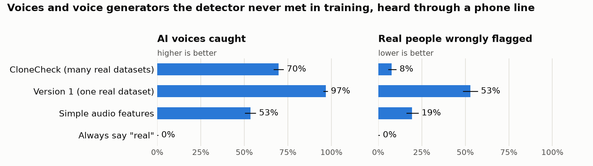

# CloneCheck: is that really your grandson on the phone?

**Track:** AI + Finance
**Team:** Gosha (solo)

*This project is a prototype and is not financial advice.*

**Notebook with all results:** [CloneCheck.ipynb](CloneCheck.ipynb) · **Starting point:** our own idea

## The problem

In a "family emergency" scam, a caller pretends to be a grandchild in trouble and asks for money right now. Free AI tools can now copy a voice from a few seconds of audio: I copied my own on a laptop in five minutes. A grandparent who hears a familiar voice asking for help has no way to tell, in the moment, whether a person or a program is speaking.

## What we built

CloneCheck helps a grandparent who gets a call from "a grandchild in trouble" by taking a few seconds of the caller's voice and saying whether it sounds like a real person or an AI-generated voice.

> **In:** two 5-second clips of *"I'm in a bit of trouble and I need your help right now."* One is me. One is an AI copy of my voice. Both are heard through a simulated phone line.
> **Out:** for my recording, **Sounds like a real person** (AI-voice score 0%). For the copy, **Sounds AI-generated** (score 26%; the alarm goes off above 8%).

That pair went well. Section 4 shows the pairs that did not. It runs as a function in the notebook and as a small web app (`python app.py`) where you record or upload a clip.

## What we added

Our own idea. The organisers' sample scam-text filter says it cannot catch family-emergency scams, because those contain no scammy words. This project goes after that case, in the form it now takes: a phone call.

- **Our own data.** 14,315 clips in English and Russian: 6,252 real voices from ten public datasets plus my own recordings, and 8,063 fake voices that I generated with eight AI voice generators, including an AI copy of my own voice.
- **Our own question.** A detector is trained on today's voice generators and today's recordings. A scam call comes from a generator it has never heard, on a microphone it has never heard, over a phone line. Does it still work then?
- **Our own user.** For a grandparent there are two different mistakes: missing a fake voice, and calling a real grandchild fake. They are reported separately everywhere.

## How it works

**Data.** Real speech comes from [FLEURS](https://huggingface.co/datasets/google/fleurs), LibriSpeech, VoxPopuli, Golos, RuLibriSpeech and five more datasets (full list under Sources). For the fake half, AI voice generators read out the same texts as the real clips, so both halves say the same kind of thing. Every clip, real or fake, is trimmed of silence, cut to 10 seconds and set to the same loudness. Each clip is scored twice: as recorded, and after a simulated landline phone call (300 to 3400 Hz, 8 kHz, mu-law).

**Model.** Each clip is passed through [XLS-R](https://huggingface.co/facebook/wav2vec2-xls-r-300m), a speech model that Meta pretrained on 436,000 hours of speech in 128 languages. We do not train XLS-R. We take the average of its layer-10 activations (1,024 numbers per clip) and train our own logistic regression on them to output the probability that the voice is AI-generated. Logistic regression was chosen because it is simple to explain and less likely to overfit a few thousand clips than a bigger model.

**Fair testing.** Everything is split by *where it came from*, not at random:

| | Train | Dev (used to choose settings) | Test (scored once, at the end) |
|---|---|---|---|
| **Voice generators** | macOS `say`, Piper, MMS | Silero | Kokoro, Bark, Chatterbox, Vosk, Chatterbox copying my voice |
| **Real-voice datasets** | FLEURS, LibriSpeech, VoxPopuli, Golos, RuLibriSpeech | English Dialects, SOVA | MInDS-14 (calls to a bank), AMI (meetings), Podlodka (podcast), my own voice |

No FLEURS sentence is shared between train, dev and test. For the other training datasets, the train, dev and test clips come from each dataset's own separate train, validation and test parts. The plan, the settings and the final clip list were each committed to this repository before the test was run; the commit history shows the order.

**Alarm level.** Set on real dev voices so that at most 5% of them are flagged, then frozen.

## Results

### 1. On voices and generators it never met, heard through a phone line

| Method | AI voices caught (new generators) | Real people wrongly flagged (new datasets) |
|---|---|---|
| Always say "real" (simplest baseline) | 0% (0 of 1,090) | 0% (0 of 580) |
| Logistic regression on simple audio features (MFCC) | 53% (583) | 19% (113) |
| Version 1: XLS-R, real voices from one dataset | 97% (1,055) | 53% (307) |
| **CloneCheck: XLS-R, real voices from five datasets** | **70% (760)** | **8% (45)** |



Of CloneCheck's 45 wrongly flagged clips, 16 are my own voice (section 4); on the three public datasets it never met, it flagged 5% (29 of 550).

On generators and datasets it *was* trained on (but new sentences and recordings), CloneCheck caught 100% of fakes (2,038 of 2,040) and flagged 4% of real voices (69 of 1,713). The gap between 100% and 70% is the cost of a generator being new.

### 2. A perfect score was the warning

Version 1 was trained with real voices from one dataset, FLEURS. On dev data it caught every fake, including Silero, a generator it had never heard. That looked too good, so we checked real voices from other datasets: it flagged 85% of LibriSpeech audiobook readers as AI. It had learned "does this sound like a FLEURS recording?", not "is this a human?". Anything that was not FLEURS was "fake", which is also why it "caught" every fake.

The fix, chosen on dev data only: real voices from five datasets in training, each training clip also heard through the phone line, and whole datasets held out for dev and test in the same way as generators. On the test set that cut wrongly flagged real people from 53% to 8%. It also dropped fakes caught from 97% to 70%. The 70% is the honest number, because the 97% came from flagging nearly everything unfamiliar.

### 3. By generator, language and gender (CloneCheck, phone line)

| Generator (never trained on) | English | Russian |
|---|---|---|
| Vosk | | 100% (315 of 315) |
| Chatterbox | 68% (61 of 90) | 64% (58 of 90) |
| Chatterbox copying my own voice | 87% (13 of 15) | 67% (10 of 15) |
| Kokoro | 54% (196 of 365) | |
| Bark | 36% (38 of 105) | 73% (69 of 95) |

- **Language.** Real voices from the public test datasets were wrongly flagged 3% of the time in English (32 of 1,125) and 6% in Russian (66 of 1,138).
- **Gender** (for the datasets that record it). Wrongly flagged: women 1% in English and 3% in Russian, men 2% and 5%. The ranges overlap, so this test does not show a gender gap, but it is too small to rule one out.

### 4. Where it fails

**It flagged me.** My own real voice, recorded on my laptop, was called AI in 5 of 15 English clips and 13 of 15 Russian clips. In Russian it flagged the real me (13 of 15) more often than it caught the AI copy of me (8 of 15).

Why we think so: my recordings were made in a browser, which removes background noise and leaves exact digital silence between words. To check, we added steady background hiss (20 dB quieter than the voice) to the same clips and scored them again:

| Clips | As recorded | With hiss added |
|---|---|---|
| My real voice, wrongly flagged as AI | 18 of 30 | 1 of 30 |
| AI copy of my voice, caught | 19 of 30 | 2 of 30 |

Hiss makes the detector say "real" for both. So part of what it has learned is "a clean recording is AI, background noise is human". That is the same kind of shortcut as version 1, one level down, and a scammer could use it: play street noise behind the cloned voice.

**It misses half of Bark.** 93 of 200 Bark clips got through, and 65 of those scored below 1%, so the detector was confidently wrong. We do not know why. Our guess is that Bark builds audio in a different way from the three generators in training, and the detector has only learned what those three sound like.

**Other limits.** The phone line is simulated, not a real call. The fake clips read sentences aloud; they do not act out a scam. The "my own voice" test is 30 clips from one person on one microphone.

## What we'd do next

- **Train against the shortcut.** Add noise, room echo and noise suppression to real and fake training clips alike, so that "how clean is it?" stops being a clue. Then test on fresh recordings made on a different device.
- **Real calls.** Play real and cloned voices through an actual phone call and record the other end.
- **More people.** Recordings from family members, with their permission, especially older voices and accented English.
- **Do not rely on the voice alone.** The safest advice stays the same whatever the detector says: hang up and call back on a number you already have.

## Sources

- **Data (real speech):** [FLEURS](https://huggingface.co/datasets/google/fleurs) (Google, CC BY 4.0); [LibriSpeech](https://www.openslr.org/12) (CC BY 4.0); [VoxPopuli](https://github.com/facebookresearch/voxpopuli) (Meta, CC0); [Golos](https://github.com/sberdevices/golos) (SberDevices), through the [10-hour crowd subset](https://huggingface.co/datasets/bond005/sberdevices_golos_10h_crowd); [RuLibriSpeech](https://huggingface.co/datasets/bond005/rulibrispeech); [English Dialects](https://huggingface.co/datasets/ylacombe/english_dialects) (Google, CC BY-SA 4.0); [SOVA RuDevices](https://huggingface.co/datasets/bond005/sova_rudevices); [MInDS-14](https://huggingface.co/datasets/PolyAI/minds14) (PolyAI, CC BY 4.0); [AMI](https://huggingface.co/datasets/edinburghcstr/ami) (CC BY 4.0); [Podlodka Speech](https://huggingface.co/datasets/bond005/podlodka_speech); 30 recordings of my own voice.
- **Voice generators (fake speech):** macOS `say`; [Piper](https://github.com/OHF-Voice/piper1-gpl) with [rhasspy/piper-voices](https://huggingface.co/rhasspy/piper-voices); [MMS-TTS](https://huggingface.co/facebook/mms-tts-eng) (Meta); [Silero](https://github.com/snakers4/silero-models); [Kokoro-82M](https://huggingface.co/hexgrad/Kokoro-82M); [Bark](https://huggingface.co/suno/bark-small) (Suno); [Chatterbox](https://github.com/resemble-ai/chatterbox) (Resemble AI); [Vosk TTS](https://github.com/alphacep/vosk-tts).
- **Pretrained model:** [XLS-R 300M](https://huggingface.co/facebook/wav2vec2-xls-r-300m) (Meta).
- **Libraries:** PyTorch, Hugging Face Transformers, scikit-learn, librosa, SciPy, pandas, soundfile, matplotlib, Gradio.
- **AI tools:** [Claude Code](https://claude.com/claude-code) (Anthropic) was used heavily as a coding assistant: it wrote most of the code and helped draft this write-up, working from my idea and direction.
- **Reference:** the hackathon's Hacker Guide, Project Briefs and sample submission, for the structure of this write-up.

## Run it yourself

```bash
git clone https://github.com/ImGosha/clonecheck.git && cd clonecheck
pip install -r requirements.txt
python scripts/evaluate_test.py     # re-trains and re-scores from the saved features, no audio needed
python app.py                       # the demo app (downloads XLS-R the first time)
```

The audio itself is too large for GitHub. The repository holds the list of every clip ([data/clips.csv](data/clips.csv)), the features each clip was turned into, and the scripts that rebuild the audio from the public datasets and generators.

| Path | What it is |
|---|---|
| `CloneCheck.ipynb` | The notebook: data, both versions, every result, every failure |
| `clonecheck/config.py` | Which generators and datasets are train, dev and test |
| `clonecheck/audio.py` | Trimming, loudness, the phone-line simulation |
| `clonecheck/features.py` | Turning a clip into numbers (MFCC and XLS-R) |
| `clonecheck/detect.py` | Training and scoring the logistic regression |
| `scripts/` | Building the clip list, generating fakes, extracting features, dev and test runs |
| `results/` | Every table behind the numbers above, and each method's score for every test clip |
| `app.py`, `record.py` | The demo app and the page used to record my own voice |
